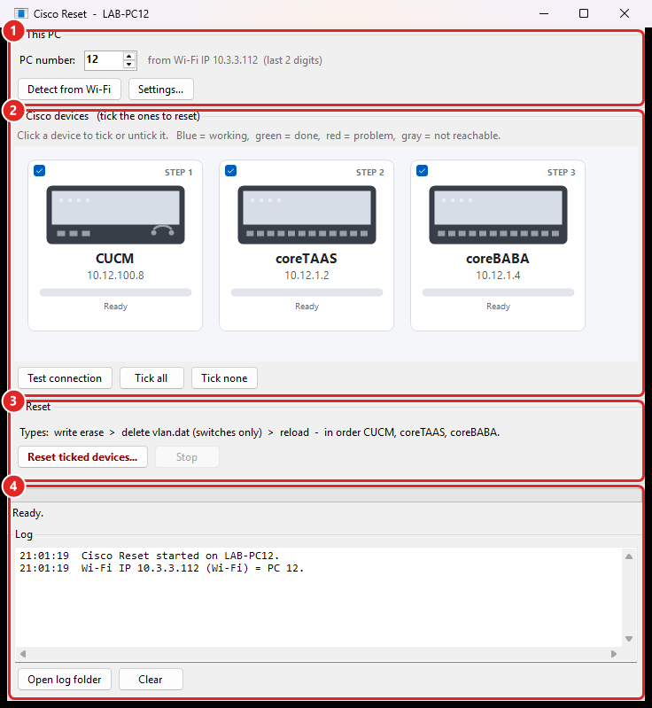
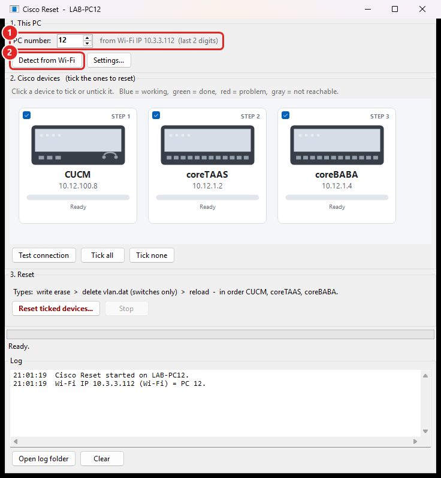
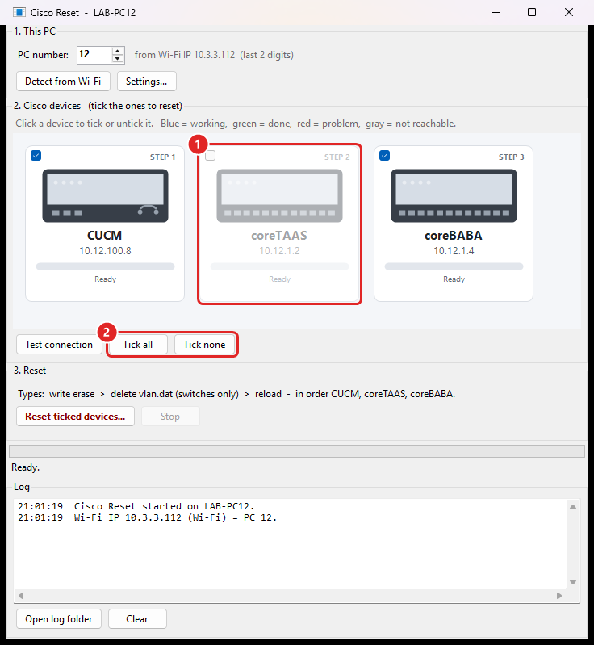
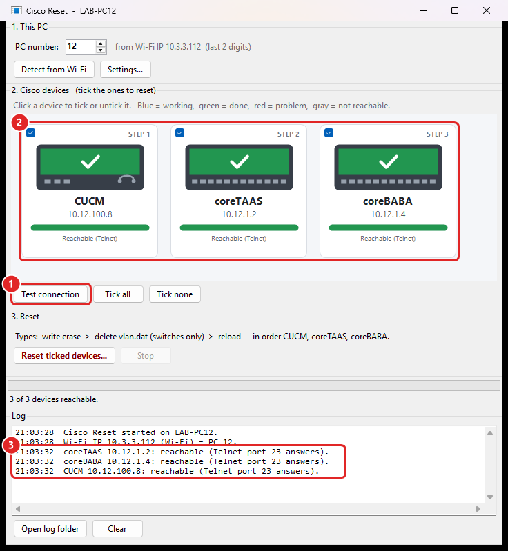
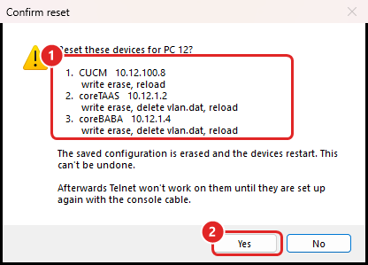
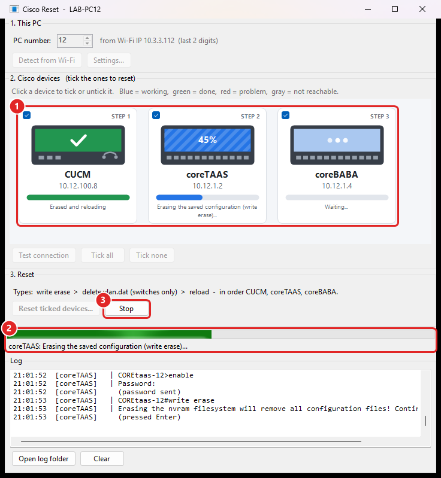
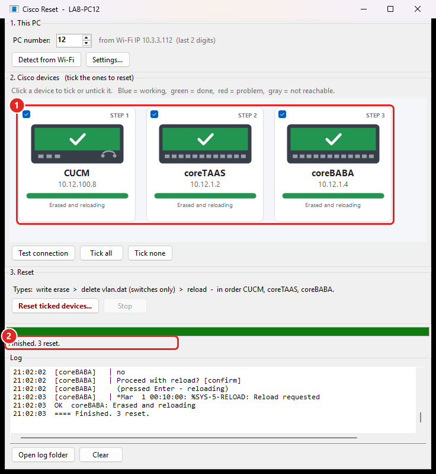
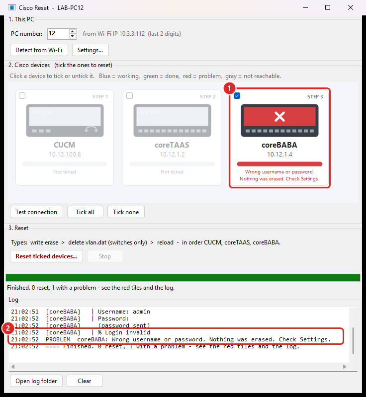
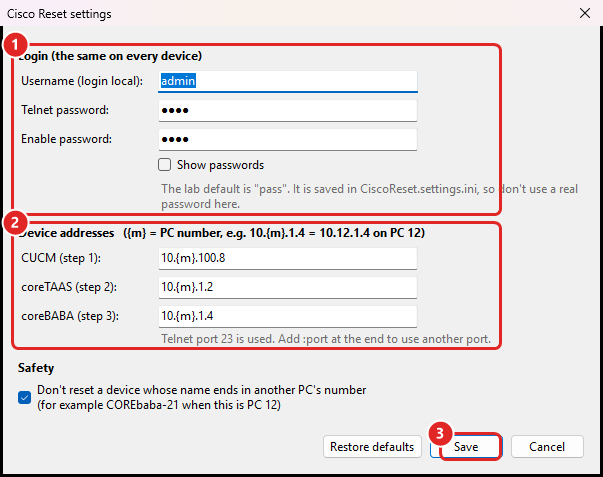

# Cisco Reset

Cisco Reset is a small Windows app that resets a lab PC's Cisco devices at the end of a class with one click. It types the same commands you would type in SecureCRT, on each device in turn:

```
pass
en
pass
wr er
delete vlan.dat
reload
```

It works on the four devices that belong to the PC it runs on:

| Step | Device | Address | What it is |
|---|---|---|---|
| 1 | **CUCM** | `10.m.100.8` | Call manager (CallManager Express on a Cisco router) |
| 2 | **EDGE** | `10.m.m.1` | Edge router (Cisco ISR 4321, IOS-XE) |
| 3 | **coreTAAS** | `10.m.1.2` | Backup core switch |
| 4 | **coreBABA** | `10.m.1.4` | Main core switch |

**`m` is the PC number**: the last 2 digits of the PC's Wi-Fi IP address. On a PC with Wi-Fi IP `10.3.3.112`, `m` is `12`, so the app resets `10.12.100.8`, `10.12.12.1`, `10.12.1.2` and `10.12.1.4`. The app works this out by itself. The edge router's address uses the PC number twice (`10.m.m.1`).

You don't need SecureCRT to use it. SecureCRT only keeps shortcuts to the devices; the configuration lives on the devices themselves, and Cisco Reset talks to them over Telnet directly. Your SecureCRT sessions are left as they are.

> The screenshots use example data: a lab PC called `LAB-PC12` with Wi-Fi IP `10.3.3.112` (PC 12).

---

## Contents

- [Part 1: Build Cisco Reset (once)](#part-1-build-cisco-reset-once)
- [Part 2: Prepare the lab PCs and devices (once)](#part-2-prepare-the-lab-pcs-and-devices-once)
- [Part 3: How to use Cisco Reset, step by step](#part-3-how-to-use-cisco-reset-step-by-step)
- [What the tile colours mean](#what-the-tile-colours-mean)
- [Troubleshooting](#troubleshooting)
- [Safety rules (built in)](#safety-rules-built-in)
- [What's in the folder](#whats-in-the-folder)
- [Exactly what it types](#exactly-what-it-types)
- [Testing without real devices](#testing-without-real-devices)

---

## Part 1: Build Cisco Reset (once)

You only need to do this once, on any PC. Then you copy the finished `CiscoReset.exe` to the lab PCs.

**What you need:** Windows 10 or 11 with .NET Framework 4.8. It's already built into Windows 10 and 11, so there's nothing to download.

### Step 1: Get the files

Choose **one** of these:

- **Option A: Download the ZIP (no Git needed)**
  1. Open https://github.com/HayzeuMagic/ciscoreset
  2. Click the green **`<> Code`** button, then **Download ZIP**.
  3. Right-click the downloaded ZIP and choose **Extract All...**. Extract it to **`C:\`**.
  4. Rename the extracted folder from `ciscoreset-main` to **`CiscoReset`**, so you end up with `C:\CiscoReset`.

- **Option B: Clone with Git**
  ```
  git clone https://github.com/HayzeuMagic/ciscoreset.git C:\CiscoReset
  ```

### Step 2: Build `CiscoReset.exe`

1. Open `C:\CiscoReset` in File Explorer.
2. Double-click **`build.bat`**.
3. A black window opens. When it says **`Built CiscoReset.exe successfully.`**, press any key to close it.

You now have **`CiscoReset.exe`** in `C:\CiscoReset`. It's the only file the lab PCs need.

> `build.bat` uses the C# compiler that comes with Windows, so you don't need Visual Studio. If it says *"Could not find the C# compiler"*, install .NET Framework 4.8 from Microsoft and run it again.

---

## Part 2: Prepare the lab PCs and devices (once)

### On every lab PC

1. Copy **`CiscoReset.exe`** to the PC, for example to `C:\CiscoReset\CiscoReset.exe`.
2. *(Optional)* Right-click it and choose **Send to > Desktop (create shortcut)**.
3. Double-click it once. If Windows SmartScreen shows *"Windows protected your PC"*, click **More info**, then **Run anyway**. This happens because you built the app yourself, so it isn't signed. Windows only asks the first time.

Cisco Reset does **not** need administrator rights. It keeps its settings and logs next to `CiscoReset.exe` (or in `%LOCALAPPDATA%\CiscoReset` if that folder is read-only).

> Don't copy `CiscoReset.settings.ini` from one PC to another. Each PC makes its own the first time it runs.

### On the devices

Cisco Reset reaches the devices over **Telnet**, so they need what the lab's *Basic Layer 3 configuration* task already sets up:

- an IP address: coreTAAS `10.m.1.2` and coreBABA `10.m.1.4` on VLAN 1, CUCM `10.m.100.8`, EDGE `10.m.m.1`
- a `vty` password (`line vty 0 14`, `password pass`, `login`) or `login local` with `username admin privilege 15 secret pass`
- an enable secret (`enable secret pass`)

**For CUCM**, the PC reaches `10.m.100.8` through coreBABA, so both of these need to be in place:

- on the PC (in an administrator Command Prompt): `route add 10.0.0.0 mask 255.0.0.0 10.m.1.4`
- on CUCM: `ip route 0.0.0.0 0.0.0.0 10.m.100.4`

If they aren't, the two switches are still reset; only CUCM shows as not reachable.

**For EDGE (the ISR 4321)**, the PC reaches `10.m.m.1` through coreBABA too (the same `route add` covers it), and the router needs:

- a route back to the PC's network (for example a default route towards coreBABA)
- Telnet allowed on its vty lines. Newer IOS-XE versions only allow SSH by default, so add:
  ```
  line vty 0 4
   transport input telnet ssh
   password pass
   login
  ```
  (or `login local` with `username admin privilege 15 secret pass`)
- `enable secret pass`

The ISR 4321 has no `vlan.dat`, so it gets `write erase` and `reload` only, like CUCM. It takes several minutes to restart.

---

## Part 3: How to use Cisco Reset, step by step

Do this on the student's PC, at the end of the class.

### Step 1: Know the screen

Double-click **`CiscoReset.exe`**. The window has four parts. You work through them in order, **1 → 2 → 3**, and watch **4**.



| # | Section | What it's for |
|---|---|---|
| **1** | **This PC** | The PC number, found from the Wi-Fi IP. **Settings...** is here too. |
| **2** | **Cisco devices** | One tile per device (CUCM, EDGE, coreTAAS, coreBABA) and **Test connection**. |
| **3** | **Reset** | The **Reset ticked devices...** button, and **Stop**. |
| **4** | **Status and log** | Overall progress, and everything that happened line by line. |

---

### Step 2: Check the PC number



1. Check that **PC number** is this PC's number. Next to it, Cisco Reset says where the number came from, here *from Wi-Fi IP 10.3.3.112 (last 2 digits)*. The tiles show the addresses for that number (`10.12.100.8`, `10.12.1.2`, `10.12.1.4`).
2. If the number is wrong, or it says **Unknown** (the PC isn't on Wi-Fi), type the right number in the box. It's remembered on this PC. **Detect from Wi-Fi** switches back to the number from the Wi-Fi IP.

> ⚠️ The PC number decides which devices get erased. Always check it before you reset.

---

### Step 3: Tick the devices you want to reset

All four devices are ticked. **Click a tile** to untick it or tick it again.



1. Click a tile to untick it. Unticked tiles look **faded** (coreTAAS here) and are left alone.
2. **Tick all** / **Tick none** tick or untick all four at once.

The ticks are remembered on this PC.

---

### Step 4: Click "Test connection"

Before resetting, check that this PC can reach each device. Nothing is changed on the devices.



1. Click **Test connection**.
2. Check the tiles: **green ✓ = reachable**, **gray – = not reachable**.
3. The log says the same for each device.

If one is gray, see [Troubleshooting](#troubleshooting). You can still reset the others.

---

### Step 5: Click "Reset ticked devices..."

1. In **section 3 (Reset)**, click **Reset ticked devices...**.
2. A **Confirm reset** window opens:



1. Check the list: the PC number, and each device with its address and what will be typed.
2. Click **Yes**. (**No** cancels; nothing is changed.)

---

### Step 6: Watch the progress



Cisco Reset works through the devices **one at a time, in order: CUCM, EDGE, coreTAAS, coreBABA**. coreBABA goes last because this PC reaches CUCM and EDGE *through* coreBABA.

1. **The tiles:** the device being reset is **blue with moving stripes** and shows its % and current step. The ones still to come are light blue (*Waiting...*), and finished ones turn green.
2. **The status bar** shows the overall progress and what is happening right now. The log below it shows each prompt from the device and each answer, with `(password sent)` in place of the password.
3. **Stop** cancels. The log says whether the device it was working on had already been erased.

The other buttons are greyed out while a reset is running.

---

### Step 7: Check the results



1. **Green ✓ = done**: the device was erased and is restarting. **Red ✗ = problem**: see the example below.
2. The status line and the end of the log sum it up: *Finished. 3 reset.* Click **Open log folder** to see the saved log files (one per day, in the `Logs` folder next to `CiscoReset.exe`).

The devices take a few minutes to restart. When they're back, they're blank (`Switch>` / `Router>`) and ready for the next class.

> ⚠️ After a reset, Telnet doesn't work on that device any more, because its IP address and `vty` password were erased too. Set it up again with the console cable, as at the start of the lab. Any SecureCRT Telnet session to the device drops when it restarts.

**Example of a problem:** someone changed coreBABA's password, so Cisco Reset couldn't log in.



1. The tile turns **red** and says what went wrong, and whether anything was erased.
2. The log shows what the device answered (`% Login invalid`).

Fix the problem (see [Troubleshooting](#troubleshooting)), tick just that device, and click **Reset ticked devices...** again.

---

### Step 8 (only if needed): Change the settings

You only need this if your lab uses a different password, username or addressing.



1. **Login:** the username for `login local` (`admin`), the Telnet password and the enable password. All are **`pass`** by default, the lab default, so normally there's nothing to type. **Show passwords** shows them.
2. **Device addresses:** `{m}` is replaced with the PC number, so `10.{m}.1.4` becomes `10.12.1.4` on PC 12. Telnet port 23 is used; add `:port` at the end to use another port.
3. Click **Save**. **Restore defaults** puts everything back to the lab defaults.

The settings are saved in `CiscoReset.settings.ini` next to `CiscoReset.exe`, **in plain text**. That's fine for the lab default `pass`, but don't put a real password there.

---

## What the tile colours mean

| Tile | Meaning |
|---|---|
| **Light gray, "Ready"** | Ticked, nothing running yet. |
| **Light blue, dots** | Waiting for its turn. |
| **Blue, moving stripes** | Working (with % done). |
| **Green ✓** | Done (or, after **Test connection**: reachable). |
| **Red ✗** | Problem. Read the tile or the log. |
| **Gray –** | Not reachable, or stopped before it started. |
| **Faded** | Not ticked. Click the tile to tick it. |

---

## Troubleshooting

| Problem | Fix |
|---|---|
| **PC number: Unknown** | The PC has no Wi-Fi IP. Type its number in section 1. |
| **Can't reach 10.m.x.x** | The device is off, not cabled, or has no IP yet. Check with `ping 10.m.1.4`. |
| **EDGE can't be reached, but coreBABA can** | Check the PC's route (as for CUCM), the 4321's route back to the PC, and that its vty lines allow Telnet (`transport input telnet ssh`). Or reset it with the console cable. |
| **CUCM can't be reached, but the switches can** | Add the PC's route (`route add 10.0.0.0 mask 255.0.0.0 10.m.1.4` in an administrator Command Prompt; it's lost when the PC restarts) and check CUCM's default route (`ip route 0.0.0.0 0.0.0.0 10.m.100.4`). Or reset CUCM with the console cable. |
| **Wrong Telnet password / Wrong enable password** | Someone changed it. Type the right one in **Settings...**, or reset that device with the console cable. |
| **Wrong username or password** | The device uses `login local` with another user (for example `namemo`). Change **Username** in **Settings...**. |
| **Telnet login isn't set up on this device** | The device has no `vty` password, so it can't be reached over Telnet. Use the console cable. |
| **"... looks like PC 21's device, not PC 12's"** | The address reached a device named for another PC. Check the PC number in section 1. See [Safety rules](#safety-rules-built-in). |
| **vlan.dat could not be deleted** | The device was erased and reloaded, but `vlan.dat` is still there. Delete it with the console cable: `delete vlan.dat`. |
| **"Windows protected your PC"** | Click **More info**, then **Run anyway**. |
| **Anything else** | Click **Open log folder** and look at today's log. It has the whole session with each device. |

---

## Safety rules (built in)

- **Nothing is erased until the login works.** A wrong password, a missing device or a timeout stops before `write erase`, and the message says *Nothing was erased*.
- **It never saves.** When `reload` asks *Save? [yes/no]*, it always answers **no**.
- **It checks the device's name.** If the hostname ends in a different PC number (for example `COREbaba-21` when this is PC 12), it refuses to reset it. Default names like `Switch` are fine. You can turn this off in **Settings...**.
- **It always asks first.** The confirm window lists every device and address.
- **Passwords are never written to the log.** The log shows `(password sent)`.

---

## What's in the folder

| File | What it is |
|---|---|
| `CiscoReset.exe` | The app (made by `build.bat`). Copy it to every lab PC. |
| `CiscoReset.settings.ini` | Saved settings, ticks and the PC number (created automatically on each PC). |
| `Logs\` | One log file per day, with everything each device answered. |
| `build.bat` + `src\` | Source code. Double-click `build.bat` to build `CiscoReset.exe`. |
| `test.bat` + `test\` | Automatic tests against pretend Cisco devices. See [Testing without real devices](#testing-without-real-devices). |
| `docs\images\` | The screenshots used in this README. |

`.gitignore` keeps the `.exe`, the settings and the logs out of Git.

---

## Exactly what it types

For each ticked device, in order CUCM, EDGE, coreTAAS, coreBABA, Cisco Reset opens a Telnet connection and waits for each prompt before answering:

| When the device shows | Cisco Reset sends |
|---|---|
| `Username:` | the username (`admin`) |
| `Password:` | the Telnet password (`pass`) |
| `COREbaba-12>` | `enable` |
| `Password:` (after `enable`) | the enable password (`pass`) |
| `COREbaba-12#` | `write erase` |
| `... Continue? [confirm]` | Enter |
| `COREbaba-12#` | `delete vlan.dat` *(switches only)* |
| `Delete filename [vlan.dat]?` | Enter |
| `Delete flash:/vlan.dat? [confirm]` | Enter |
| `COREbaba-12#` | `reload` |
| `Save? [yes/no]:` | `no` |
| `Proceed with reload? [confirm]` | Enter |

When the device drops the connection to restart, that device is done.

- If `vlan.dat` isn't there, that's fine: the log says so and it carries on.
- With `login local` (`username admin privilege 15`), the device goes straight to `#`, so `enable` is skipped.
- If someone left the device in config mode (`(config)#`), it types `end` first.

---

## Testing without real devices

`test.bat` builds and runs automatic tests against **pretend** Cisco devices (`test\FakeIos.cs`), so no switch is needed. They check a normal reset of a switch, of the CUCM router and of the ISR 4321 edge router (IOS-XE), `login local`, a missing `vlan.dat`, wrong passwords and usernames, another PC's device, a device without a `vty` password, and an unreachable device. Double-click `test.bat`; it should end with **`31 passed, 0 failed.`**

The pretend devices only copy the prompts of real ones. Before using Cisco Reset in class, try it once on a real lab PC: run **Test connection**, reset one device (for example coreTAAS, the backup switch), and check it on the console cable.
